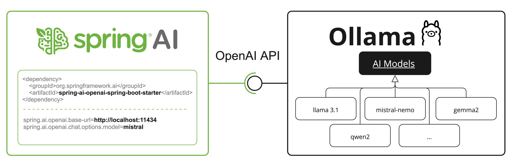

# Spring AI Ollama Lab

A Spring Boot application that integrates with Ollama to provide AI chat capabilities via REST API.

## Prerequisites

- Java 21 or higher
- Maven 3.6+
- Ollama installed and running locally
- Ollama model (e.g., `qwen2.5:3b` or `llama3.2`)

## Installation

### 1. Install Ollama

Download and install Ollama from [https://ollama.com](https://ollama.com)

### 2. Start Ollama Server

```bash
ollama serve
```

### 3. Pull a Model

```bash
ollama pull qwen2.5:3b
# or
ollama pull llama3.2
```

### 4. Clone and Build the Project

```bash
cd spring-ai-ollama-lab
mvn clean install
```

## Configuration

The application is configured via `src/main/resources/application.properties`:

```properties
spring.application.name=spring-ai-ollama-lab
server.port=8081

# Ollama connection
spring.ai.ollama.base-url=http://localhost:11434

# AI model (change to your installed model)
spring.ai.ollama.chat.model=qwen2.5:3b
```

Update the `spring.ai.ollama.chat.model` property to match the model you have installed.

## Running the Application

Start the application using Maven:

```bash
mvn spring-boot:run
```

The application will start on `http://localhost:8081`

## API Endpoint

### POST /api/chat

Send a message to the AI model and receive a response.

**Request Body:**
```json
{
  "message": "Explain Spring AI in one sentence"
}
```

**Response:**
```json
{
  "response": "Spring AI is a framework that provides abstractions for integrating AI capabilities into Spring applications."
}
```

## Testing with Postman

### Step 1: Create a New Request

1. Open Postman
2. Click "New" → "HTTP Request"

### Step 2: Configure the Request

- **Method:** POST
- **URL:** `http://localhost:8081/api/chat`

### Step 3: Set Headers

Add the following header:
- **Key:** `Content-Type`
- **Value:** `application/json`

### Step 4: Set Body

1. Go to the "Body" tab
2. Select "raw"
3. Choose "JSON" from the dropdown
4. Paste the following:

```json
{
  "message": "What is Spring Boot?"
}
```

### Step 5: Send the Request

Click "Send" and you will receive the AI response.

### Example Postman Screenshots

**Request:**
```
POST http://localhost:8081/api/chat
Content-Type: application/json

{
  "message": "Hello, how are you?"
}
```

**Response:**
```json
{
  "response": "Hello! I'm doing well, thank you for asking. How can I assist you today?"
}
```

## Project Structure

```
spring-ai-ollama-lab/
├── src/
│   ├── main/
│   │   ├── java/com/site/spring_ai_ollama_lab/
│   │   │   ├── config/
│   │   │   │   └── AppConfig.java          # ChatClient bean configuration
│   │   │   ├── controller/
│   │   │   │   └── ChatController.java     # REST API endpoint
│   │   │   ├── dto/
│   │   │   │   ├── ChatRequest.java        # Request DTO
│   │   │   │   └── ChatResponse.java       # Response DTO
│   │   │   ├── service/
│   │   │   │   └── ChatService.java        # Business logic
│   │   │   └── SpringAiOllamaLabApplication.java
│   │   └── resources/
│   │       └── application.properties      # Configuration
└── pom.xml
```

## Troubleshooting

### Application fails to start with "ChatClient bean not found"

Ensure:
1. Ollama is running (`ollama serve`)
2. The model specified in `application.properties` is installed
3. The `spring.ai.ollama.base-url` is correct (default: `http://localhost:11434`)

### Connection refused to Ollama

Make sure Ollama is running:
```bash
ollama serve
```

### Model not found

Pull the model or update `spring.ai.ollama.chat.model` in `application.properties`:
```bash
ollama pull llama3.2
```

## Technologies Used

- Spring Boot 4.1.2
- Spring AI 2.0.1
- Ollama
- Maven
- Java 21

## License
Addis Ababa University, CTBE, SiTE - created for educational purpose.
